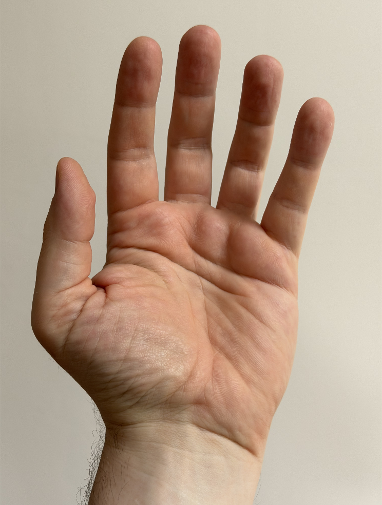
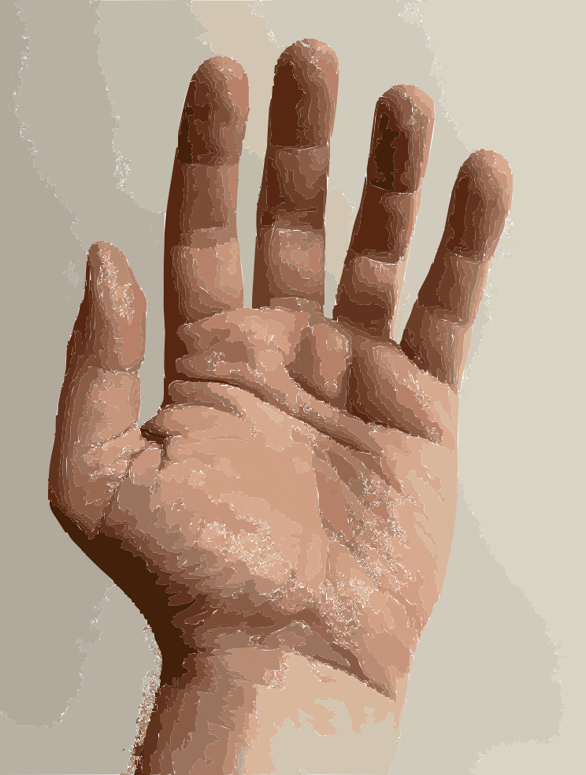
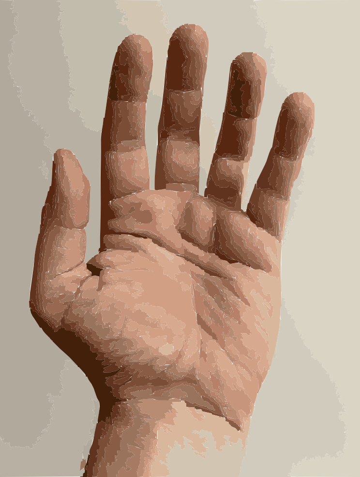
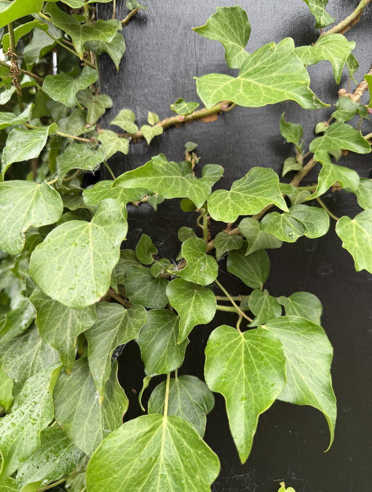
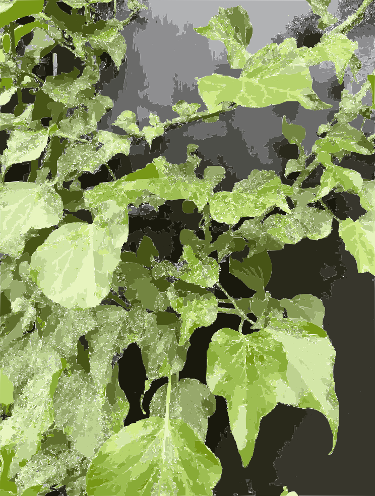
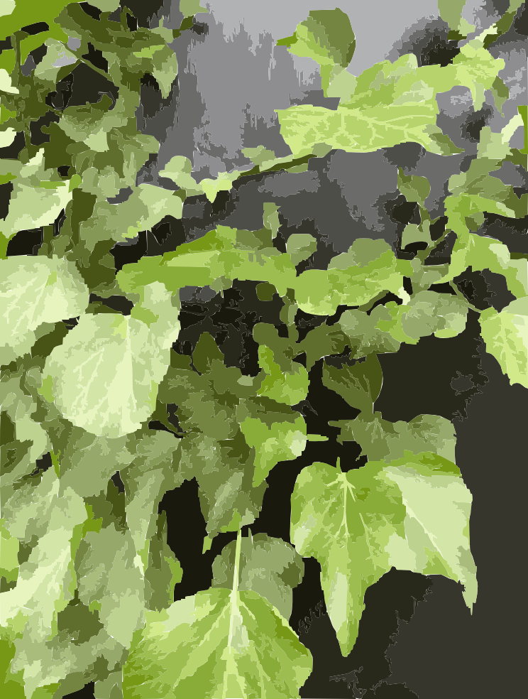

# Image Trace Noise: two photographic examples

Supporting evidence for storytold/vectorcraft#819 and the `fix/trace-noise-regions` contribution. Results collected on 10 October 2026. Code: commit `4c8ce191`, based on `cbacb47fdb0eb506022055be72f27caf4e776bc1`.

These photographs and derived previews are shared by @andeecollard for review of this bug. Publishing them here does not designate them CC0 or grant a corpus redistribution licence. Please obtain an explicit licence before incorporating them into a distributed test corpus. This evidence branch is separate from the code PR.

## Reproduction

Each input is 744 × 984. Parameters: 21 colours, Paths 65, Corners 60, abutting, Ignore White off. Use the per-image parameters.json for Noise 200; change only noise to 12 for the lower-threshold test.

```sh
vectorcraft-cli run --in hand/input.png --cmd select.all --cmd imageTrace.makeAndExpand --params "$(cat hand/parameters.json)" --export hand.svg --export hand.png
```

| Photo | Before: Noise 12 | Before: Noise 200 | Fixed: Noise 12 | Fixed: Noise 200 |
|---|---:|---:|---:|---:|
| Hand | 5,606 | 7,378 | 1,757 | 307 |
| Ivy | 22,874 | 31,172 | 6,410 | 672 |

Counts are paths. Results at Noise 0, 12, 25, 50, 100 and 200, including anchors and input SHA-256 hashes, are in results.json. Timings there include opening, tracing and SVG/PNG export during other compilation; they are not a controlled benchmark. All 12 SVG outputs were checked for the reported path count and absence of embedded raster images.

## Hand

| Original | Before, Noise 200 | Fixed, Noise 200 |
|---|---|---|
|  |  |  |

## Ivy

| Original | Before, Noise 200 | Fixed, Noise 200 |
|---|---|---|
|  |  |  |

## Scope and validation

The fix merges complete connected regions in deterministic increasing-area order. Higher Noise continues the same merge sequence. The generated-grid regression fails on the old implementation and passes with the fix. Native workspace tests, formatting, Clippy, assets, brands and layering checks passed. The full CI gate did not pass: the local Homebrew Rust installation lacked wasm32-unknown-unknown, so web compilation was not verified.

Peak memory at Noise 200 increased from approximately 33 to 69 MiB for hand and 69 to 71 MiB for ivy. Lower path counts and reduced speckling do not establish Illustrator parity. No Adobe application or source was used.
